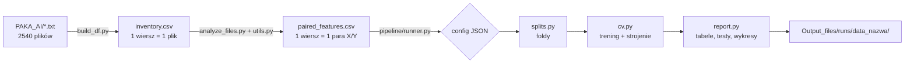

# Przewodnik po projekcie OFDR-ML-TempPressure

Ten dokument jest dla osoby, która pierwszy raz otwiera repozytorium i zna tylko temat projektu.
Po lekturze powinieneś wiedzieć: co mierzymy, skąd biorą się dane, jak przechodzą przez kod, jak działa
eksperyment, gdzie są wyniki i jak samodzielnie wszystko uruchomić.

Spis treści:
1. [O co chodzi w projekcie](#1-o-co-chodzi-w-projekcie)
2. [Dane pomiarowe](#2-dane-pomiarowe)
3. [Obraz całości](#3-obraz-całości)
4. [Etap A: od plików do tabeli cech](#4-etap-a-od-plików-do-tabeli-cech)
5. [Etap B: eksperymenty](#5-etap-b-eksperymenty)
6. [Modele](#6-modele)
7. [Schematy walidacji](#7-schematy-walidacji)
8. [Eksperymenty specjalne](#8-eksperymenty-specjalne)
9. [Wyniki: gdzie są i jak je czytać](#9-wyniki-gdzie-są-i-jak-je-czytać)
10. [Jak uruchomić projekt](#10-jak-uruchomić-projekt)
11. [Mapa plików](#11-mapa-plików)
12. [Pułapki i konwencje, o których trzeba wiedzieć](#12-pułapki-i-konwencje-o-których-trzeba-wiedzieć)
13. [Słowniczek](#13-słowniczek)
14. [Co czytać dalej](#14-co-czytać-dalej)

---

## 1. O co chodzi w projekcie

**Cel:** na podstawie pomiaru światłowodowego jednocześnie wyznaczyć **zmianę temperatury (ΔT)** i **ciśnienie
hydrostatyczne (p)**, porównując model fizyczny z artykułu z modelami uczenia maszynowego.

**Jak mierzymy.** Urządzenie Luna OBR 4600 wykonuje pomiar OFDR (Optical Frequency Domain Reflectometry).
Mierzy rozpraszanie Rayleigha wzdłuż włókna i zwraca **przesunięcie widmowe Δν** [GHz] w każdym punkcie
(co ok. 1 mm). Przesunięcie zmienia się, gdy włókno się nagrzewa albo jest ściskane.

**Dlaczego światłowód K-SHF.** To włókno z otworami bocznymi (side-hole), które ma dwa kanały polaryzacyjne,
**X** (wolny) i **Y** (szybki). Kanały reagują inaczej:

| bodziec | kanał X | kanał Y |
|---|---|---|
| temperatura | ≈ −1,4 GHz/°C | ≈ −1,4 GHz/°C (prawie to samo) |
| ciśnienie | ≈ +0,7 GHz/MPa | ≈ −1,9 GHz/MPa (przeciwny znak) |

Z jednego kanału nie da się odróżnić „cieplej” od „większe ciśnienie”. Z dwóch kanałów można, bo temperatura
przesuwa je razem, a ciśnienie w przeciwne strony. Stąd dwie kluczowe wielkości:
- **m = (μ_X + μ_Y)/2**, składowa wspólna, niesie głównie temperaturę,
- **d = μ_X − μ_Y**, składowa różnicowa, niesie głównie ciśnienie.

**Model fizyczny z artykułu** (Bednarek i in., Optics Express 2026):

```
Δν_k = A_k·ΔT² + B_k·ΔT + C_k·p ,   k ∈ {X, Y}
```

Dwa równania z dwiema niewiadomymi (ΔT, p) rozwiązuje się analitycznie. To jest nasz punkt odniesienia
(baseline). Pytanie badawcze brzmi: **czy ML poprawia, utrzymuje czy pogarsza wynik względem tego modelu?**

Dokumenty źródłowe (poza repozytorium, w folderze nadrzędnym):
- `Projekt_3__NW.pdf` – instrukcja projektu,
- `Załącznik_do_Projektu_3.pdf` – dodatkowe wymagania: cecha Xinter, Nyström-SVR, Residual Drift, zysk G,
- `oe-34-2-2543.pdf` – artykuł referencyjny,
- `OBR-4600-UG6_SW3.10.1.pdf` – instrukcja urządzenia.

Projekt trwa drugi semestr. Semestr 1 zbudował pipeline i porównanie modeli. Semestr 2 realizuje 11 zadań
od prowadzącego (nowe modele, walidacja między seriami, ograniczanie kalibracji, okna przestrzenne,
niepewność); opis w `docs/`.

---

## 2. Dane pomiarowe

Dane leżą w folderze `PAKA_AI/` (nie ma go w gicie, `.gitignore`; trzeba go skopiować ręcznie).

### Struktura folderów

```
PAKA_AI/
  DT24.7_T50_20/                      <- jeden folder = jedna seria pomiarowa = jedna temperatura
    20_CH1_Y_FAST/                    <- kanał Y
      Switch_channel_1-0MPa-1.txt     <- ciśnienie 0 MPa, powtórzenie nr 1
      Switch_channel_1-0.5MPa-3.txt   <- ciśnienie 0,5 MPa, powtórzenie nr 3
      Switch_channel_1-11MPa-1.txt    <- pomiar "zero_end" (patrz niżej)
      ...
    20_CH2_X_SLOW/                    <- kanał X, te same nazwy plików z channel_2
```

Nazwa folderu `DT24.7_T50_20` koduje trzy rzeczy:

| fragment | znaczenie | kolumna w danych |
|---|---|---|
| `DT24.7` | zmiana temperatury ΔT = 24,7 °C | `dT` (`deltaT_label`) |
| `T50` | temperatura płyty grzewczej 50 °C | `Tp` (`T_plate_label`) |
| `20` | numer serii | `series_id` |

### Zawartość pliku

Plik `.txt` z OBR ma nagłówek (data akwizycji, rozdzielczość, długość bramki 1 cm, odstęp punktów ~1 mm),
a pod nim dwie kolumny: `Length (m)` i `Spectral Shift (GHz)`. To profil przesunięcia wzdłuż całego włókna
(od 0 do ~13 m). Analizujemy tylko odcinek w komorze ciśnieniowej: **ROI 8,5–12 m**.

### Liczby

- **9 serii**, każda w innej temperaturze: ΔT = 0; 16,2; 20,5; 24,7; 27,4; 33; 37,5; 41,8; 45,7 °C.
  Każda seria była mierzona innego dnia (czerwiec–wrzesień 2025).
- **14 poziomów ciśnienia**: 0; 0,1; 0,2; 0,5; 1; 2; …; 10 MPa (nie w każdej serii wszystkie).
- **ok. 10 powtórzeń** każdego warunku (numer na końcu nazwy pliku).
- 2540 plików, czyli 1270 par X/Y. Po kontroli jakości zostaje **1225 próbek**, a 119 różnych kombinacji (ΔT, p).

### Typy punktów i korekta etykiet ciśnienia

| etykieta w nazwie pliku | ciśnienie po korekcie | typ punktu | do czego służy |
|---|---|---|---|
| 0 MPa | 0 | `zero_start` | pomiar przed cyklem ciśnienia; normalne dane |
| 0,1–10 MPa | bez zmian | `pressure_point` | normalne dane |
| **11 MPa** lub **0,01 MPa** | **0** | `zero_end` | pomiar **po** cyklu ciśnienia; tylko analiza powtarzalności |

Etykiety 11 i 0,01 MPa to umowne oznaczenia powrotu do zera, a nie prawdziwe ciśnienia. Bez tej korekty
błąd ciśnienia rośnie ok. 10 razy (ablacja 3). Mapowania zapisano w `other_output/pressure_label_mapping.csv`
i `other_output/channel_mapping.csv` (CH1 → Y, CH2 → X).

---

## 3. Obraz całości

Projekt ma dwa etapy. Pierwszy zamienia surowe pliki na jedną tabelę. Drugi uruchamia na tej tabeli
eksperymenty opisane w plikach konfiguracyjnych.



Ten sam przepływ w punktach:
1. `python main.py setup` → `inventory.csv` → `training_dataset.csv` → **`paired_features.csv`**
2. `python main.py run` (albo inne polecenie) → config z `configs/` → foldy → modele → wyniki w `Output_files/runs/`.

---

## 4. Etap A: od plików do tabeli cech

Uruchamiany poleceniem `python main.py setup` (funkcja `prepare()` w [main.py](../main.py)).

### Krok 1: naprawa struktury (`utils.fix_dt16_folder_structure`)

W folderze `DT16.2_T42_02` oznaczenia CH1/CH2 były zamienione względem reszty. Wykryliśmy to automatycznie
(`analyze_files.detect_channel_swap`): czułości ciśnieniowe X i Y muszą mieć przeciwne znaki. Funkcja zmienia
nazwy folderów i plików na poprawne. Jest idempotentna, więc kolejne uruchomienia nic nie zmieniają.

### Krok 2: inwentaryzacja (`build_df.build_dataframe` → `inventory.csv`)

Dla każdego pliku `.txt` powstaje jeden wiersz. Z nazwy folderu i pliku odczytywane są: dT, Tp, seria,
kanał, ciśnienie (z korektą 11/0,01 → 0), typ punktu i numer powtórzenia (`rep_idx`). Dodatkowo:
- `pair_id` – ścieżka do pliku drugiego kanału tego samego pomiaru,
- `reference_zero_id` – ścieżka do pomiaru `zero_start` z tej samej serii i tego samego powtórzenia,
- **flagi ról** (prawda/fałsz), które decydują, do czego rekord jest używany:

| flaga | warunek | używana przez |
|---|---|---|
| `is_temp_calibration` | p = 0 i `zero_start` | AN-BL: kalibracja temperaturowa (A, B) |
| `is_pressure_calibration` | ΔT = 0, p od 0 do 10, nie `zero_end` | AN-BL: kalibracja ciśnieniowa (C) |
| `is_joint_regression` | p od 0 do 10, nie `zero_end`, kompletna para | główny zbiór dla wszystkich modeli |
| `is_repeatability_test` | `zero_end` | tylko analiza powtarzalności, nigdy trening |

Rekordy kalibracyjne są podzbiorem `is_joint_regression`.

`python main.py prepare_broken` tworzy wersje `*_broken.csv` bez korekty 11/0,01 MPa. Służą wyłącznie do
ablacji 3, która pokazuje, co się psuje bez korekty.

### Krok 3: cechy (`analyze_files.build_folder_summary` → `paired_features.csv`)

Dla każdej pary X/Y:
1. Wczytanie obu plików (`utils.read_measurement_file`).
2. **Czyszczenie ROI** (`utils.clean_roi`): wycięcie 8,5–12 m, odrzucenie 2 punktów z każdego brzegu, usunięcie
   NaN, odrzucenie punktów odstających (robust z-score > 3,5 względem mediany i MAD).
   Jeśli zostaje mniej niż 90 % punktów, rekord dostaje `low_quality = True` i nie trafia do eksperymentów (45 z 1270).
3. **Cechy** liczone z oczyszczonego ROI:

| cecha | znaczenie |
|---|---|
| `mu_X`, `mu_Y` | średnie przesunięcie w ROI – **najważniejsze cechy** |
| `std_X`, `std_Y`, `iqr_X`, `iqr_Y` | rozrzut sygnału wzdłuż ROI (niejednorodność) |
| `m`, `d` | składowa wspólna i różnicowa (patrz punkt 1) |
| `Xinter` | `mu_X · mu_Y`, cecha interakcyjna z załącznika |

Wynik to `Output_files/paired_features.csv`: jeden wiersz = jedna próbka modelowa (para X/Y w danym warunku).
Są w nim cechy, etykiety (`pressure`, `dT`, `Tp`), metadane (`series_id`, `rep_idx`, `point_type`,
`sample_id`, `ref`) i flagi ról. **Wszystkie eksperymenty czytają tylko ten plik.**

`python main.py info` wypisuje liczności ról.

---

## 5. Etap B: eksperymenty

Kod w folderze [pipeline/](../pipeline). Każdy eksperyment jest opisany plikiem JSON w [configs/](../configs),
a polecenia `main.py` to skróty do konkretnych configów.

### Plik konfiguracyjny

Przykład (skrócona wersja [configs/main_condition.json](../configs/main_condition.json)):

```json
{
  "name": "main_condition",
  "split": "condition",
  "inner_cv": {"n_splits": 3, "group": "condition_id"},
  "features": ["mu_Y", "mu_X", "m", "d", "std_Y", "std_X", "iqr_Y", "iqr_X"],
  "models": ["AN-BL", "AN-BL-NEAREST", "AN-JOINT", "CD-LIN", "MO-LR", "POLY2-RIDGE", "SVR-RBF"],
  "baseline": "AN-BL"
}
```

Najważniejsze klucze (wartości domyślne są w `DEFAULTS` w [pipeline/runner.py](../pipeline/runner.py)):

| klucz | znaczenie |
|---|---|
| `split` | schemat walidacji: `condition`, `temperature`, `series`, `pressure`, `block` |
| `features` | cechy dla modeli ML (modele analityczne i CD-* mają własne, stałe cechy) |
| `models` | lista modeli z rejestru (`pipeline/models.py`) |
| `baseline` | model odniesienia dla testów parowanych i zysku G |
| `common_folds` | na których foldach liczyć tabelę główną: `"baseline"` (domyślnie), `"all"` albo lista modeli |
| `temperature_target` | `"dT"` (domyślnie) albo `"Tp"` |
| `inner_cv` | wewnętrzne strojenie: liczba podziałów i kolumna grupująca (`series_id` albo `condition_id`) |
| `grids` | nadpisanie siatek hiperparametrów |
| `model_params` | nadpisanie parametrów modeli, np. punkt kalibracji AN-BL / AN-BL-NEAREST: `calibration_temperature` (jednostki celu, `null` = ΔT = 0), `calibration_pressure` (MPa, domyślnie 0), `pressure_calibration` (`strict` / `nearest_temperature`), `temperature_calibration` (`strict` / `nearest_pressure`) |
| `variants` | lista wariantów; każdy nadpisuje dowolne klucze i trafia do osobnego podkatalogu |

### Co dzieje się po uruchomieniu (`runner.run_from_config`)

1. Wczytanie configu i danych (`load_data`): usunięcie `low_quality`, dodanie `condition_id`.
2. **Podział na foldy** (`splits.make_folds`): lista par (etykieta folda, maska testu).
3. **Dla każdego folda** (`cv.run_cv`, na ekranie `>>> FOLD i/N`):
   - **trening** = wszystko spoza testu; modele ML uczą się tylko na `is_joint_regression`
     (bez `zero_end`), modele analityczne korzystają z flag kalibracyjnych,
   - **strojenie hiperparametrów** (`GridSearchCV`) odbywa się wyłącznie wewnątrz treningu, z podziałem
     grupowym (`GroupKFold`), i minimalizuje kryterium
     `S = 0,5·MAE_T/SD(T) + 0,5·MAE_p/SD(p)`, które równoważy obie wielkości,
   - **predykcja** na teście (główne metryki) i osobno na `zero_end` z tego folda (analiza powtarzalności),
   - model, którego nie da się skalibrować na danych folda, dostaje status `not_identifiable` (N/A).
     Nie ma żadnych współczynników domyślnych.
4. **Raport** (`report.build_report`): tabele, testy statystyczne, zysk G, powtarzalność, wykresy.
5. Zapis wszystkiego do `Output_files/runs/<data>_<nazwa>/` i ścieżki do `Output_files/runs/LATEST.txt`.

### Metryki (`pipeline/metrics.py`)

Dla ciśnienia i temperatury osobno: MAE, RMSE, MaxAE, bias (średni błąd ze znakiem, pred − true) i R².
R² liczone w foldzie, w którym cel jest stały (np. jedna temperatura), byłoby bez sensu, więc wtedy wynosi
NaN. R² dla złączonych predykcji jest w osobnej tabeli `pooled_metrics`.

**Zysk G** względem modelu odniesienia (z załącznika): `G = (RMSE_base − RMSE_model) / RMSE_base · 100 %`.

---

## 6. Modele

Rejestr: [pipeline/models.py](../pipeline/models.py), implementacje: [baselines/models/](../baselines/models).

| model | rodzaj | cechy | opis |
|---|---|---|---|
| **AN-BL** | analityczny | μ_X, μ_Y | model z artykułu, kalibracja sekwencyjna: A, B z p = 0, C z serii ΔT = 0 |
| **AN-BL-NEAREST** | analityczny | μ_X, μ_Y | jak AN-BL; bez serii kalibracyjnej ΔT bierze C z najbliższej dostępnej temperatury, a bez punktów kalibracyjnego p bierze A, B z najbliższego dostępnego poziomu ciśnienia |
| **AN-JOINT** | analityczny | μ_X, μ_Y | ta sama fizyka, wszystkie współczynniki dopasowane razem na wszystkich danych |
| **CD-LIN** | ML | m, d | regresja liniowa na składowej wspólnej i różnicowej |
| **CD-POLY** | ML | m, d | wielomian 2. stopnia (m, d, m², d², m·d) z regularyzacją Ridge |
| **MO-LR** | ML | `features` z configu | wielowyjściowa regresja liniowa |
| **POLY2-RIDGE** | ML | `features` | wielomian 2. stopnia + Ridge |
| **SVR-RBF** | ML | `features` | maszyna wektorów nośnych z jądrem RBF |
| **NYSTROEM-SVR** | ML | `features` | SVR z aproksymacją jądra (z załącznika) |
| **RF** | ML | `features` | las losowy (słabo ekstrapoluje, zwykle najgorszy) |

Szczegółowy opis trzech modeli analitycznych: [modele_analityczne_dT_Tp.md](modele_analityczne_dT_Tp.md).

---

## 7. Schematy walidacji

Jedna próbka to średnia z ROI, ale ok. 10 powtórzeń tego samego warunku jest do siebie bardzo podobnych.
Losowy podział wierszy wpuściłby więc „prawie te same” próbki do treningu i testu. Dlatego wszystkie
schematy dzielą dane **grupami** (`pipeline/splits.py`):

| schemat (polecenie) | test w jednym foldzie | foldów | charakter |
|---|---|---|---|
| `condition` (`run`, **główny**) | jedna kombinacja (ΔT, p), wszystkie powtórzenia | 119 | interpolacja |
| `temperature` (`run_temp`) | cała jedna temperatura | 9 | nowa temperatura |
| `series` (`run_series`) | cała jedna seria | 9 | w tych danych = `temperature` |
| `pressure` (`run_pressure`) | jeden poziom ciśnienia we wszystkich temperaturach | 14 | nowe ciśnienie |
| `block` (`run_block`) | prostokąt w przestrzeni (ΔT, p), np. wysoka T i wysokie p | 4 | dziura w danych |

Bloki definiuje się w configu (`blocks`), np. `{"name": "high_T_high_p", "T_min": 37.5, "p_min": 7}`.

Interpretacja wyników w różnych schematach jest w
[modele_analityczne_dT_Tp.md, punkt 4](modele_analityczne_dT_Tp.md#4-cztery-schematy-walidacji).

---

## 8. Eksperymenty specjalne

Mają własny kod, ale ten sam mechanizm configów (klucz `"experiment"`).

| polecenie | kod | pytanie | opis |
|---|---|---|---|
| `ablations` | zwykłe CV z wariantami | które elementy pipeline'u są potrzebne? | 4 vs 8 cech, jeden kanał, brak korekty etykiet, zero_end w treningu |
| `run_reduced` | [pipeline/reduced_calibration.py](../pipeline/reduced_calibration.py) + [calibration_design.py](../pipeline/calibration_design.py) | ile stanów kalibracyjnych naprawdę potrzeba? | [pkt6_7.md](pkt6_7.md) |
| `run_spatial` | [pipeline/spatial.py](../pipeline/spatial.py) | jak dokładność zależy od długości okna wzdłuż włókna? | [pkt6_7.md](pkt6_7.md) |

`run_spatial` jako jedyny wraca do surowych plików `.txt`. Za pierwszym razem zapisuje cache
`Output_files/spatial_bins_1cm.npz`.

---

## 9. Wyniki: gdzie są i jak je czytać

Każde uruchomienie tworzy katalog `Output_files/runs/<data>_<nazwa>/`. Najważniejsze pliki, w kolejności,
w jakiej warto je otwierać:

| plik | zawartość |
|---|---|
| `results_table.md` | **tabela główna**: średnia (odchylenie) metryk po foldach dla każdego modelu |
| `results_per_fold.md` | wynik każdego modelu w każdym foldzie |
| `gain_vs_baseline.md` | zysk G względem modelu odniesienia |
| `paired_tests.md` | test Wilcoxona, test t, efekt Cohena vs model odniesienia |
| `fold_status.md` | gdzie model był N/A |
| `repeatability_*` | dryft `zero_end` − `zero_start` i Residual Drift |
| `predictions.csv`, `folds.csv` | surowe predykcje i metryki (do własnych analiz, np. `ML_results.ipynb`) |
| `config_resolved.json`, `run_meta.json` | pełna konfiguracja, commit gita, wersje bibliotek, hash danych |
| `*.png` | wykresy RMSE, prawda vs predykcja, histogramy reszt |

Każda tabela jest zapisywana w trzech formatach: `.csv` (pełna precyzja), `.md` (podgląd) i `.tex` (do raportu).

### Orientacyjne wyniki (cel ΔT)

| model | condition: RMSE_p / RMSE_T | temperature: RMSE_p / RMSE_T |
|---|---|---|
| AN-BL | 0,113 / 0,102 | 0,142 / 0,140 (8 z 9 foldów) |
| AN-JOINT | 0,061 / 0,097 | 0,082 / 0,144 |
| MO-LR | 0,057 / 0,107 | 0,077 / 0,196 |
| SVR-RBF | 0,059 / 0,089 | 0,195 / 0,824 |
| RF | 0,544 / 0,301 | 1,504 / 4,496 |

Źródła: `20261017_134111_main_condition` i `20261017_164636_main_temperature`. Najkrócej:
- modele liniowe i fizyczne skalibrowane łącznie są najlepsze w ciśnieniu,
- w temperaturze model fizyczny pozostaje bardzo mocny,
- modele elastyczne (SVR, RF) psują się przy niewidzianej temperaturze.

---

## 10. Jak uruchomić projekt

1. Środowisko (Python 3.12):
   ```
   python -m venv .venv
   .venv\Scripts\activate                 # Windows
   pip install -r requirements.txt
   ```
2. Skopiuj folder z danymi `PAKA_AI/` do katalogu repozytorium.
3. Przygotuj dane (raz, kilka minut):
   ```
   python main.py setup
   ```
4. Uruchom eksperymenty:
   ```
   python main.py run              # główny: leave-one-condition-out (119 foldów, najdłuższy – dziesiątki minut)
   python main.py run_temp         # leave-one-temperature-out
   python main.py run_pressure     # leave-one-pressure-out
   python main.py run_block        # usunięte bloki T x p
   python main.py ablations
   python main.py run_reduced      # pkt 6 (~25 min)
   python main.py run_spatial      # pkt 7
   python main.py experiment configs/analytical_dT_vs_Tp.json   # modele analityczne, dT vs Tp (~30 s)
   python main.py help             # lista wszystkich poleceń
   ```
   Polecenia można łączyć: `python main.py setup run ablations`.
5. Wyniki: `Output_files/runs/LATEST.txt` wskazuje ostatnie uruchomienie. Notebook `ML_results.ipynb`
   rysuje błędy per temperatura dla ostatniego uruchomienia.

Własny eksperyment: skopiuj plik z `configs/`, zmień klucze i uruchom
`python main.py experiment configs/moj.json`.

---

## 11. Mapa plików

```
OFDR-ML-TempPressure/
├─ main.py                  wejście: polecenia setup / run / ... (skróty do configów)
├─ build_df.py              inwentaryzacja plików, korekta etykiet, pary X/Y, flagi ról
├─ analyze_files.py         czytanie plików, cechy z ROI, wykrywanie zamiany kanałów
├─ utils.py                 naprawa folderu DT16.2, czytanie .txt, czyszczenie ROI (clean_roi), stałe ROI
├─ configs/                 definicje eksperymentów (JSON)
├─ pipeline/
│  ├─ runner.py             config → dane → CV → raport → katalog wyników; warianty, metadane
│  ├─ splits.py             schematy podziału na foldy
│  ├─ cv.py                 pętla po foldach, strojenie (GridSearchCV + GroupKFold), predykcje
│  ├─ models.py             rejestr modeli: budowa, siatki, cechy, minimalna liczba stanów
│  ├─ metrics.py            metryki, wybór celu temperaturowego (dT / Tp)
│  ├─ report.py             tabele, testy statystyczne, zysk G, powtarzalność, wykresy
│  ├─ reduced_calibration.py, calibration_design.py   pkt 6: mniej punktów kalibracji
│  └─ spatial.py            pkt 7: okna przestrzenne
├─ baselines/models/        implementacje modeli (physical_model.py = AN-BL, AN-BL-NEAREST, AN-JOINT)
├─ docs/                    opisy etapów i analiz
├─ 01_preprocessing.ipynb   EDA (rozkłady, korelacje)
├─ DisplayDF.ipynb          podgląd tabeli inwentaryzacji
├─ ML_results.ipynb         analiza predykcji z ostatniego uruchomienia
├─ other_output/            mapowania kanałów i etykiet ciśnienia
├─ PAKA_AI/                 surowe dane (poza gitem)
└─ Output_files/            tabele pośrednie i wyniki uruchomień (poza gitem)
```

---

## 12. Pułapki i konwencje, o których trzeba wiedzieć

1. **Używamy bezwzględnego μ, a nie różnicy względem `zero_start`.** Instrukcja każe liczyć przesunięcie
   względem pomiaru `zero_start` danej serii. Pliki OBR zawierają jednak już przesunięcie względem jednego
   globalnego pomiaru referencyjnego (temperatura pokojowa, 0 MPa). Odjęcie `zero_start` usunęłoby całą
   informację o temperaturze serii, bo w danej serii temperatura jest stała.
2. **`dT` czy `Tp`.** Modele używają domyślnie `dT`. Etykieta `Tp` daje 5–6 razy większe błędy temperatury
   dla wszystkich modeli, a `dT` jest podejrzanie zgodna z sygnałem; szczegóły w
   [modele_analityczne_dT_Tp.md](modele_analityczne_dT_Tp.md). Przełączanie: `"temperature_target": "Tp"`.
3. **Leave-one-series-out = leave-one-temperature-out.** Każda seria to jedna temperatura i jeden dzień pomiarów.
4. **Leave-one-condition-out to test interpolacyjny.** Testowa temperatura i ciśnienie są w treningu w innych
   kombinacjach, a powtórzenia pochodzą z tej samej serii. Daje najlepsze liczby, więc w raporcie zawsze
   pokazujemy obok schematy `temperature`, `pressure` i `block`.
5. **N/A to nie błąd.** AN-BL nie ma danych kalibracyjnych w foldzie ΔT = 0 (leave-one-temperature-out)
   i p = 0 (leave-one-pressure-out). Tabela główna podaje `n_folds` każdego modelu, a testy parowane i zysk G
   liczone są na foldach wspólnych dla pary modeli.
6. **Średnich z różnych schematów nie porównujemy wprost**: inne foldy, inny skład testu. Porównujemy modele
   w obrębie jednego schematu.
7. **`zero_end` nigdy nie trafia do treningu ani do głównych metryk**, chyba że config ustawia
   `include_zero_end_train` (tylko ablacja 4).
8. **Cechy usunięte celowo:** `Pdir` z załącznika była liczona z posortowanych etykiet ciśnienia, więc
   przemycała etykietę do cech (przeciek). Szczegóły w [etap0.md](etap0.md).
9. **Seria ΔT = 16,2 °C jest nietypowa**: zmierzona 2,5 miesiąca przed resztą, odstająca czułość, brak
   niskich ciśnień. Zwykle to najtrudniejszy fold.

---

## 13. Słowniczek

| pojęcie | znaczenie |
|---|---|
| OFDR / OBR | reflektometria w dziedzinie częstotliwości / urządzenie Luna, które ją wykonuje |
| przesunięcie widmowe Δν | zmiana sygnału Rayleigha w danym punkcie włókna [GHz] |
| K-SHF | światłowód z otworami bocznymi, dwa kanały polaryzacyjne X i Y |
| ROI | analizowany odcinek włókna (8,5–12 m), w komorze |
| μ_X, μ_Y | średnie przesunięcie w ROI dla kanału X i Y |
| m, d | składowa wspólna (μ_X + μ_Y)/2 i różnicowa μ_X − μ_Y |
| seria | jeden przebieg pomiarowy w jednej temperaturze, wszystkie ciśnienia i powtórzenia |
| warunek (condition) | jedna kombinacja (ΔT, p) |
| zero_start / zero_end | pomiar przy 0 MPa przed / po cyklu ciśnienia |
| fold | jeden podział trening/test w walidacji krzyżowej |
| nested CV | zewnętrzna walidacja (ocena) + wewnętrzna (strojenie hiperparametrów tylko na treningu) |
| N/A (`not_identifiable`) | model nie dał się skalibrować na danych treningowych folda |
| baseline | model odniesienia, domyślnie AN-BL |
| zysk G | procentowa zmiana RMSE względem modelu odniesienia |
| Residual Drift (RD) | błąd powrotu do zera: odległość predykcji dla `zero_end` od (T_start, 0) |

---

## 14. Co czytać dalej

1. [README.md](../README.md) – instalacja i lista poleceń (po angielsku).
2. [docs/etap0.md](etap0.md) – co poprawiono w pipeline na początku semestru 2 i dlaczego.
3. [docs/modele_analityczne_dT_Tp.md](modele_analityczne_dT_Tp.md) – modele analityczne, etykieta
   temperatury, interpretacja schematów walidacji.
4. [docs/pkt6_7.md](pkt6_7.md) – ograniczanie kalibracji i okna przestrzenne.
5. Instrukcja `Projekt_3__NW.pdf` i artykuł `oe-34-2-2543.pdf` – kontekst naukowy.
